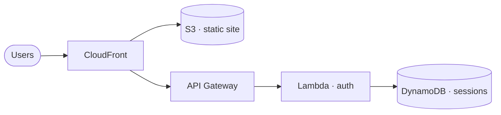

<div align="center">

# `cbx`

### Plan it before you build it. Audit it after you ship it.

**The CloudBooster CLI — architecture plans from plain English, and AWS audits<br>grounded in curated cloud expertise instead of generic advice.**

[](https://github.com/cloudbooster-io/cbx-cli/actions/workflows/ci.yml)
[](https://github.com/cloudbooster-io/cbx-cli/releases)
[](https://pkg.go.dev/github.com/cloudbooster-io/cbx-cli)
[](https://goreportcard.com/report/github.com/cloudbooster-io/cbx-cli)
[](LICENSE)

</div>

---

## Describe it. Get an architecture.

```console
$ cbx plan "static site with auth"
```

`cbx plan` turns an intent into `plan.md` — components, trade-offs, and a Mermaid
diagram, ready to drop into a PR or design doc:



- **Bring your own LLM — no CloudBooster account needed.** Use an Anthropic or
  OpenAI API key (`cbx llm api login claude|codex`), or a CLI you already have
  installed — Claude Code or Codex CLI (`cbx llm cli list`).
- **Headless or interactive.** One-shot from a script, or an in-terminal chat
  to iterate on the plan.
- **Your diagram, your format.** Mermaid embedded by default; `--diagram d2`
  also emits a standalone `plan.d2`, `--html` adds a browser preview.

## Point it at AWS. Get grounded findings.

```console
$ cbx audit aws prod --region eu-central-1

  HIGH     S3 bucket "data-prod" has no public-access block
  WARNING  CloudTrail "main" has log file validation disabled
  WARNING  IAM user "deploy-bot" has a console password but no MFA
  INFO     2 unattached Elastic IPs accruing charges
                                            (output abridged)
```

`cbx audit aws` reads a live account through the AWS SDK — **strictly
read-only** — and grounds every finding in CloudBooster's curated AWS
knowledge base, analyzed with [Claude Code](https://github.com/anthropics/claude-code)
(`claude` must be on your `PATH`). You get findings that cite *why* something
matters, written to a markdown report.

Audit the default profile, a named one, or several regions at once:

```bash
cbx audit aws
cbx audit aws prod --region us-east-1 --region us-west-2
```

## Install

| Platform | |
|---|---|
| **macOS** | `brew tap cloudbooster-io/tap && brew install --cask cbx-cli` |
| **Debian / Ubuntu** | `sudo dpkg -i cbx-cli_*_linux_amd64.deb` — from [Releases](https://github.com/cloudbooster-io/cbx-cli/releases) |
| **Fedora / RHEL** | `sudo rpm -i cbx-cli_*_linux_amd64.rpm` — from [Releases](https://github.com/cloudbooster-io/cbx-cli/releases) |
| **Windows** | `scoop bucket add cloudbooster https://github.com/cloudbooster-io/scoop-bucket && scoop install cbx-cli` |
| **Anything else** | grab an archive from [GitHub Releases](https://github.com/cloudbooster-io/cbx-cli/releases) |

Every release is Cosign-signed and ships a Syft SBOM. Once installed,
`cbx upgrade` keeps you current and `cbx doctor` checks your setup.

## Quick start

```bash
# 1. Pick a model for `cbx plan` — an API key, or a CLI you already have
cbx llm api login claude        # Anthropic API key (BYO)
cbx llm cli list                # …or detect Claude Code / Codex CLI on PATH

# 2. Plan
cbx plan "three-tier web app with a queue between api and workers"

# 3. Audit (read-only; needs AWS credentials + `claude` on PATH)
cbx audit aws
```

`cbx login` is optional — it unlocks CloudBooster account features, but
planning works anonymously.

## Built for scripting

Every command takes `-o json` (a stable `{data, error}` envelope), `-q/--quiet`,
and `--no-color`. Audit exit codes encode the worst finding, man-page style:

| Exit code | Meaning |
|:---:|---|
| `0` | clean — no findings |
| `1` | worst finding: **info** |
| `2` | worst finding: **warning** |
| `3` | worst finding: **high / critical** |

```bash
# CI gate: tolerate info/warning, fail the pipeline on high or critical
cbx audit aws -o json -q || [ $? -lt 3 ]
```

## Use it as a Go library

`pkg/` is a semver-stable public API — `cbx` is built to be embedded:

```go
import (
    "github.com/cloudbooster-io/cbx-cli/pkg/audit" // programmatic audits, Pulumi/Terraform state parsing
    "github.com/cloudbooster-io/cbx-cli/pkg/cmd"   // embed the full CLI in your own tool
)
```

`pkg/audit` also exposes a fully offline path (state-file parsing, no LLM, no
network) alongside `pkg/auth`, `pkg/config`, and `pkg/output`.

<details>
<summary><b>Full command reference</b></summary>

<br>

| Command | Description |
|---------|-------------|
| `cbx plan "<intent>"` | Generate an architecture plan |
| `cbx audit aws [profile]` | Audit a live AWS account (read-only, grounded in CloudBooster's AWS knowledge) |
| `cbx llm api login <claude\|codex>` | Store an API key for an LLM provider (bring your own key) |
| `cbx llm cli list` | List local CLI executors (Claude Code, Codex CLI) detected on PATH |
| `cbx llm list` | Show all configured API providers and CLI executors |
| `cbx llm default <name>` | Set the default LLM provider |
| `cbx llm model [name] [model]` | Show or pin the model a provider/executor uses (`--clear` reverts) |
| `cbx login` / `cbx logout` / `cbx status` | CloudBooster account session |
| `cbx doctor` | Check installation health |
| `cbx upgrade` | Upgrade cbx to the latest release |
| `cbx completion` | Generate shell completion |
| `cbx version` | Print version |

Run `cbx --help` (or `cbx <command> --help`) for the full set, including
`cbx auth`, `cbx config`, `cbx env`, and `cbx telemetry`.

</details>

## Development

Go 1.25+ and `make` are all you need:

```bash
make build      # → bin/cbx
make test       # unit + local e2e
make vet lint   # static checks
```

(`make test-e2e-staging` targets CloudBooster's internal staging API and is
maintainer-only.) Contributions welcome — see [CONTRIBUTING.md](CONTRIBUTING.md).

---

<div align="center">

Apache-2.0 · [Changelog](CHANGELOG.md) · [Security policy](SECURITY.md) · [Code of Conduct](CODE_OF_CONDUCT.md)

</div>
