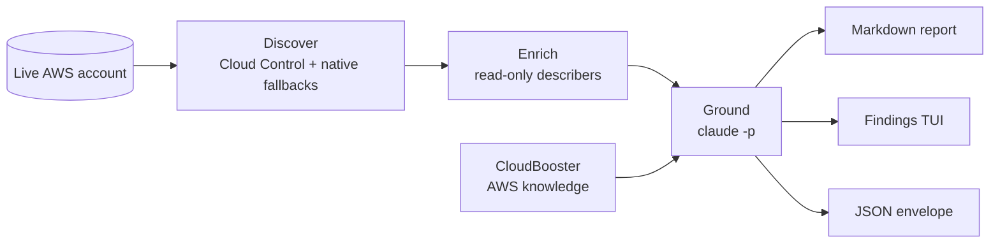

# cbx

**The CloudBooster CLI** — plan, audit, and manage cloud infrastructure from your terminal.

[](https://github.com/cloudbooster-io/cbx-cli/releases)
[](https://pkg.go.dev/github.com/cloudbooster-io/cbx-cli)
[](LICENSE)

[Install](#install) • [Quick start](#quick-start) • [Audit](#audit-a-live-aws-account) • [Plan](#plan-with-your-own-llm) • [Go library](#use-as-a-go-library)

```sh
cbx plan "three-tier web app with Postgres and a CDN"   # → plan.md with an embedded Mermaid diagram
cbx audit aws production --region eu-central-1          # read-only audit, grounded in curated AWS knowledge
```

- **Grounded audits** — discover live AWS resources (Cloud Control + native fallbacks), enrich them with read-only describers, and ground every finding in CloudBooster's curated AWS knowledge.
- **BYO-LLM planning** — turn a one-line intent into an ADR-style architecture plan. Your API key or your local Claude Code / Codex CLI; no CloudBooster account required.
- **CI-native** — severity-mapped exit codes, a stable `{"data", "error"}` JSON envelope on every command, `--dry-run`, `--strict`.
- **Embeddable** — `pkg/` is a semver-stable Go library; the state parsers and finding pipeline run fully offline.

## Install

### macOS — Homebrew

```sh
brew tap cloudbooster-io/tap
brew install --cask cbx-cli
```

Release binaries are not Apple-notarized; the cask strips the `com.apple.quarantine` attribute on install, so `cbx` runs without a Gatekeeper prompt.

### Linux — .deb / .rpm

Download the package for your architecture from [GitHub Releases](https://github.com/cloudbooster-io/cbx-cli/releases), then:

```sh
sudo dpkg -i cbx-cli_*.deb   # Debian / Ubuntu
sudo rpm  -i cbx-cli-*.rpm   # Fedora / RHEL
```

### Windows — Scoop

```sh
scoop bucket add cloudbooster https://github.com/cloudbooster-io/scoop-bucket
scoop install cbx-cli
```

### Anywhere — Go or pre-built archives

```sh
go install github.com/cloudbooster-io/cbx-cli/cmd/cbx@latest   # Go 1.25+
```

Pre-built archives for every platform are on [GitHub Releases](https://github.com/cloudbooster-io/cbx-cli/releases), named `cbx-cli_<Os>_<Arch>.tar.gz` (`.zip` on Windows) with the OS title-cased and `amd64` published as `x86_64` — e.g. `cbx-cli_Linux_x86_64.tar.gz`. Every release ships `checksums.txt` (SHA256) signed with keyless [Cosign](https://github.com/sigstore/cosign) (a `.sigstore.json` bundle) plus a Syft SBOM.

Once installed, `cbx` maintains itself:

```sh
cbx doctor    # 8 health checks: version, OS/arch, config dir, API, LLM auth, claude CLI, update currency, keychain
cbx upgrade   # detects how cbx was installed (brew / deb / rpm / scoop) and upgrades in place
```

## Quick start

```sh
# 1. Plan — bring your own LLM; no CloudBooster account or login needed
cbx llm api login claude        # API key into the OS keyring; becomes the default if none is set
cbx plan "static site with a CDN and a contact-form Lambda"
# → plan.md (ADR-style, embedded Mermaid diagram)

# 2. Audit — read-only scan of a live AWS account
cbx audit aws my-profile --region eu-central-1
# → interactive findings TUI + <accountID>_audit_report.md
```

`cbx login` is optional throughout — it connects the CLI to a CloudBooster account, which `cbx plan` never requires.

## Audit a live AWS account

`cbx audit aws [profile|console-url]` audits a single account in four stages — pass a named profile, or even paste an AWS console URL and the region is parsed from its hostname:



1. **Discover** — a curated CloudFormation type set via the Cloud Control API across the resolved regions, plus native per-service fallbacks for types Cloud Control silently drops.
2. **Enrich** — read-only describers (`s3:GetBucketPolicy`, `ec2:DescribeInstances`, …) add the configuration detail findings depend on.
3. **Ground** — CloudBooster's curated AWS knowledge is fetched, inlined into a prompt alongside the inventory, and cited by a local `claude -p` run.
4. **Report** — `<accountID>_audit_report.md`, an interactive findings TUI (skipped under `--no-tui`, `-o json`, `--quiet`, or no TTY), and machine output via `-o json`.

> [!NOTE]
> The audit is **read-only**. The exact least-privilege IAM policy it needs lives in [`docs/cbx-audit-aws-iam.json`](docs/cbx-audit-aws-iam.json). Run with `--diagnose` to list every denied call plus a recommended IAM policy patch, or `--dry-run` to see the full audit plan — regions, resource types, estimated CloudTrail Read events — before a single call is made.

> [!IMPORTANT]
> `cbx audit aws` requires [Claude Code](https://claude.com/claude-code) (`claude`) on your PATH — grounding findings in CloudBooster's curated AWS knowledge is the point of the audit, not an option. The LLM spend is yours, budget-checked by `--llm-max-cost` (default `2.00` USD): exceeding the cap surfaces as a warning finding rather than aborting the run; `0` disables it.

<details>
<summary><strong>Credential and region resolution</strong></summary>

Credentials, first match wins: `--credentials-file` → positional `[profile]` → `$AWS_PROFILE` → the `default` profile.

Regions, first match wins:

1. `--region` (repeatable; `--region all` audits every enabled region)
2. the region parsed from a pasted console URL's hostname
3. a persisted fallback, set once with `cbx config set aws.default_region eu-central-1`
4. the profile's configured region
5. an interactive picker of enabled regions (TTY only)

</details>

| Flag | Default | Purpose |
|---|---|---|
| `--region` | profile region | Repeatable; `--region all` audits every enabled region |
| `--credentials-file` | — | Explicit AWS shared-credentials file (overrides profile resolution) |
| `--dry-run` | off | Print the audit plan and exit — no AWS discovery or LLM calls |
| `--diagnose` | off | Emit per-call IAM permission errors and a recommended policy patch |
| `--llm-max-cost` | `2.0` | USD ceiling for the grounded analysis; overruns surface as a warning finding (`0` = no cap) |
| `--aws-concurrency` | `4` | Max concurrent AWS API calls per service |
| `--no-tui` | off | Print the static report instead of the interactive findings viewer |
| `--strict` | off | Gate the exit code on discovery-integrity warnings too (CI) |

### CI: exit codes and JSON

The exit code is the worst finding's severity — gate pipelines without parsing output:

| Exit code | Meaning |
|---|---|
| `0` | No findings |
| `1` | Worst finding is **info** (or a runtime error occurred) |
| `2` | Worst finding is **warning** |
| `3` | Worst finding is **high** or **critical** |

Discovery-integrity warnings (`CBX-DISCOVERY-INTEGRITY` — independent re-list probes that catch Cloud Control silently returning empty results) are advisory by default; pass `--strict` to make them gate the exit code.

Every command honors the global `-o json` flag and emits one stable envelope, `{"data": <payload>, "error": <detail or null>}`. For audits, `data` carries identity, regions, resource count, findings, components, permission errors, and integrity warnings:

```sh
cbx audit aws --no-tui -o json | jq '.data.findings'
```

## Plan with your own LLM

`cbx plan` is BYO-LLM: you bring an API key or a local agent CLI, and no CloudBooster account is needed. Configure providers once:

```sh
cbx llm api login claude     # or codex — API key stored in the OS keyring
cbx llm cli list             # detect local executors on PATH: Claude Code (claude-code), Codex CLI (codex)
cbx llm default claude       # default for plan/audit — `claude` = API provider, `claude-code` = local executor
```

Run `cbx plan` with no arguments for an interactive REPL (turn-by-turn refinement in a TUI), or pass the intent for a one-shot run — headless runs (`--no-tui`, `-o json`, or no TTY) require an explicit intent:

```sh
cbx plan "event-driven ingestion into a data lake" -d ./plans --variants 2
```

| Artifact | When |
|---|---|
| `plan.md` | Always — ADR-style plan with an embedded Mermaid diagram |
| `plan.d2` | With `--diagram d2` |
| `plan-v2.md` | With `--variants 2` (the free tier caps variants at 2) |
| Local HTML preview | With `--html` (`--port` to pin a port, `--no-open` to skip the browser) |

`--llm <name>` overrides the default provider for a single run.

## Commands

| Command | Description |
|---|---|
| `cbx plan ["intent"]` | Generate an architecture plan — REPL without an intent, one-shot with one |
| `cbx audit aws [profile\|url]` | Audit a live AWS account (alias: `cbx audit a`) |
| `cbx llm` | Manage providers — `api login/logout/list/test`, `cli list/test`, `list`, `default` |
| `cbx login` / `logout` / `status` | CloudBooster authentication (also grouped under `cbx auth`; `status` aliases `whoami`) |
| `cbx config` | Persistent settings — `set`, `get`, `list` |
| `cbx telemetry` | `status`, `enable`, `disable` |
| `cbx doctor` | Check the health of your cbx installation |
| `cbx upgrade` | Upgrade cbx to the latest version |
| `cbx version` | Print the version of cbx |
| `cbx completion` | Generate shell completion (bash, zsh, fish, powershell) |

Run `cbx --help` (or `cbx <command> --help`) for the full command set, including `cbx auth` and `cbx env`.

## Configuration and environment

Global flags on every command: `-o json` (stable machine-readable envelope), `-q`/`--quiet` (suppress non-error output), `--no-color` (disable styling).

| Variable | Effect |
|---|---|
| `CBX_CONFIG_DIR` | Override the config directory location |
| `CBX_NO_UPDATE_CHECK=1` | Disable the background update check |
| `CBX_TELEMETRY=0\|1` | Force telemetry off/on, overriding config |
| `DO_NOT_TRACK=1` | Disable telemetry ([DNT convention](https://consoledonottrack.com)) |
| `CBX_LLM_TOKEN` | Provide the key to `cbx llm api login` non-interactively |
| `CBX_SENTRY_DSN` | Redirect error reports to another Sentry project (`-` disables) |
| `AWS_PROFILE` | Profile for `cbx audit aws` when none is passed |
| `CI=true` | Skip the first-run telemetry prompt and the update banner |

Telemetry is anonymous and scrubbed — error reports and usage metrics (command name, duration, success/failure) only. Flag values, arguments, env vars, file contents, paths, account IDs, API keys, ARNs, hostname, and system user are **never** sent. Opt out any time with `cbx telemetry disable`.

## Use as a Go library

cbx-cli is the Apache-2.0 open-core edition, consumed as a library by downstream tools. The `pkg/` tree — `pkg/audit`, `pkg/auth`, `pkg/config`, `pkg/output` — is the semver-stable surface: pure facades over `internal/`, with the binary entrypoint kept to ~10 lines so the whole CLI is embeddable via `pkg/cmd`.

The audit pipeline runs fully offline for IaC state files — zero network calls, no external binaries, no account:

```go
import "github.com/cloudbooster-io/cbx-cli/pkg/audit"

findings, err := audit.Collect(audit.Options{
	StateFile:    "terraform.tfstate", // Terraform or Pulumi state
	MockScanners: true,                // built-in zero-network provider set
})
if err != nil { /* ... */ }
for _, f := range findings {
	fmt.Println(f.Severity, f.RuleID, f.Title)
}
```

Beyond `Collect`, the surface includes `CollectContext` (caller-side cancellation), `CollectFromResources` (the AWS-mode entry that takes pre-discovered resources), `Run`, `ExitWithSeverity` (maps findings to the canonical exit codes), the severity constants, the `Finding` / `DiscoveredResource` / `Component` types, and the `FindingProvider` interface for plugging in custom scanners. See the [Go Reference](https://pkg.go.dev/github.com/cloudbooster-io/cbx-cli) for the full surface.

## Development

```sh
make build          # → bin/cbx, with version/commit/date injected via ldflags
make test           # go test ./...
make test-e2e       # go test -v ./e2e/...
make lint           # golangci-lint run ./...
make vet            # go vet ./...
make codegen-check  # verify the generated API client matches api/openapi.yaml

# run a single test
go test -v -run TestExitWithSeverityHigh ./internal/audit/
```

Requires Go 1.25+ (`go.mod` declares `go 1.25.0`, toolchain `go1.26.4`).

## Contributing

Contributions are welcome — see [CONTRIBUTING.md](CONTRIBUTING.md) and the [Code of Conduct](CODE_OF_CONDUCT.md). Bugs and ideas go to [GitHub Issues](https://github.com/cloudbooster-io/cbx-cli/issues); report vulnerabilities per [SECURITY.md](SECURITY.md) (security@cloudbooster.io). Releases are tracked in the [CHANGELOG](CHANGELOG.md).

## License

[Apache-2.0](LICENSE) — third-party notices in [NOTICE](NOTICE).

---

<p align="center"><sub>cbx — the open-source CloudBooster CLI · Apache-2.0</sub></p>
